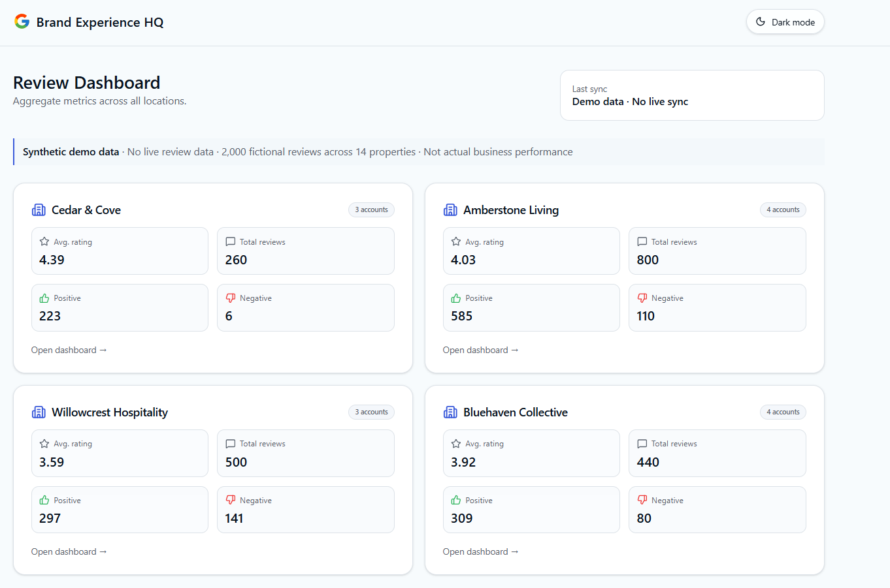

# Brand Experience HQ

### Hospitality Review Intelligence & Guest Experience Analytics Platform

**Guest feedback, sentiment, ratings and follow-up actions across brands and properties, in one dashboard.**

 

  

<a href="#executive-overview">Overview</a> &nbsp;|&nbsp;
<a href="#business-challenge">Challenge</a> &nbsp;|&nbsp;
<a href="#proposed-solution">Solution</a> &nbsp;|&nbsp;
<a href="#dashboard-experience">Dashboard</a> &nbsp;|&nbsp;
<a href="#my-role-and-contributions">My Role</a> &nbsp;|&nbsp;
<a href="#data-sources-and-integration-status">Data Sources</a> &nbsp;|&nbsp;
<a href="#project-documentation">Documentation</a>

  

The live dashboard is an interactive demonstration that uses fictional data.

  

Multi-brand overview: average rating, total reviews, positive reviews and negative reviews by brand

---

## Executive Overview

**Brand Experience HQ** is a hospitality review intelligence dashboard. It monitors guest feedback, analyzes sentiment, compares brand and property performance, identifies recurring feedback themes and supports guest experience improvement.

The demonstration presents a multi-brand hospitality group, so a reviewer can start with a portfolio-level comparison and move down to an individual brand and property.

| Audience | What they use it for |
| :-- | :-- |
| **Leadership and brand teams** | Comparing guest experience across brands |
| **Property and operations teams** | Reviewing property-level ratings, feedback and open issues |
| **Guest experience teams** | Tracking recurring themes and follow-up actions |

---

## Business Challenge

Hospitality businesses receive guest feedback across many properties and brands. Understanding the overall guest experience becomes difficult when feedback, ratings and operational follow-up are viewed separately.

- **Difficulty monitoring guest satisfaction** across multiple brands and properties
- **Limited visibility** into positive and negative guest feedback
- **Challenges identifying recurring themes** in what guests say
- **Difficulty comparing** property-level performance
- **A need for structured tracking** of guest experience issues and follow-up actions
- **A need for one consolidated view** of review and sentiment performance

---

## Proposed Solution

Brand Experience HQ brings guest experience reporting into one centralized dashboard.

| Capability | What it shows |
| :-- | :-- |
| **Multi-brand performance overview** | Brands compared side by side |
| **Property-level review analytics** | Performance for each property within a brand |
| **Average rating and total reviews** | Headline guest satisfaction and review volume |
| **Positive and negative review analysis** | The balance of favourable and unfavourable feedback |
| **Sentiment trends over time** | How sentiment moves across the selected period |
| **Rating distribution** | How ratings are spread, not only the average |
| **Recurring guest feedback themes** | The topics guests mention repeatedly |
| **Staff recognition and shoutouts** | Team members guests have praised |
| **Review-linked action tracking** | Follow-up actions with open and resolved statuses |

---

## Dashboard Experience

### Portfolio Overview

The overview compares four brands on average rating, total reviews, positive reviews and negative reviews.

### Brand-Level Reporting

Each brand view covers property performance, date and location filters, sentiment trends, sentiment distribution, rating distribution, recurring guest feedback themes, staff shoutouts and review-linked action items with open and resolved statuses.

<table>
  <tr>
    <td width="50%" align="center">
      
       <b>Amberstone Living</b>
       Four properties: property performance, sentiment and feedback themes
    </td>
    <td width="50%" align="center">
      
       <b>Bluehaven Collective</b>
       Four properties: ratings, review analysis and action tracking
    </td>
  </tr>
  <tr>
    <td width="50%" align="center">
      
       <b>Cedar &amp; Cove</b>
       Three properties: guest sentiment, rating distribution and shoutouts
    </td>
    <td width="50%" align="center">
      
       <b>Willowcrest Hospitality</b>
       Three properties: property comparison, themes and follow-up status
    </td>
  </tr>
</table>

### Demonstration at a Glance

| Item | Detail |
| :-- | :-- |
| Fictional guest reviews | 2,000 |
| Fictional brands | 4 |
| Fictional properties | 14 |
| Cedar &amp; Cove | 3 properties |
| Amberstone Living | 4 properties |
| Willowcrest Hospitality | 3 properties |
| Bluehaven Collective | 4 properties |

---

## Key Dashboard Capabilities

| Capability | What it provides |
| :-- | :-- |
| **Consolidated reporting** | Brand, property, rating, sentiment and action views in one place |
| **Performance monitoring** | Average rating, review volume, and positive and negative review counts |
| **Comparative analysis** | Brand-to-brand and property-to-property comparison |
| **Interactive exploration** | Date and location filters, with drill-down from overview to brand |
| **Guest feedback insight** | Recurring themes, sentiment trends and staff shoutouts |
| **Follow-up visibility** | Review-linked action items with open and resolved statuses |

---

## My Role and Contributions

This is a **collaborative dashboard development project**. My involvement focused on:

- Planning the dashboard and organizing business requirements for guest review reporting
- Shaping the dashboard presentation: overview, brand views and how insights are laid out
- Hospitality review analytics: ratings, sentiment, feedback themes and property comparison
- Organizing business insights so guest experience issues connect to follow-up actions

---

## Skills and Tools

| Area | Skills |
| :-- | :-- |
| **Dashboard development** | Lovable, dashboard design, interactive reporting |
| **Business intelligence** | Hospitality analytics, guest experience reporting, business performance monitoring |
| **Data and analytics** | Review data organization, sentiment visualization, rating analysis, property-level comparisons, feedback analysis |

---

## Data Sources and Integration Status

This section describes exactly what the project does and does not include today.

| Area | Current status |
| :-- | :-- |
| **Review data** | Fictional demonstration reviews |
| **Google Reviews and TripAdvisor** | Labels used within the demo review data. **Not live platform integrations.** |
| **Booking.com** | Not included |
| **Google branding** | Decorative. It is not evidence of a live Google Reviews connection. |
| **Database infrastructure** | Lovable Cloud database is configured but currently contains no populated brands, reviews or import sources |
| **Google Sheets import** | Supported for tabs named `Review Log` and `Flagged Queue`. No Google Sheets connection is currently configured. |
| **Data consistency** | The demo data stays the same on refresh |
| **Access** | Viewing the dashboard does not require sign-in. Editing and synchronization are protected. |

> **Note:** The project does not claim live Google Reviews synchronization, live TripAdvisor synchronization, automatic review collection or Booking.com integration.

---

## Business Value

- **Better visibility** into guest experience across brands and properties
- **Comparison** across brands and properties on the same measures
- **Identification of recurring feedback patterns** through themes and sentiment trends
- **Monitoring** of positive and negative sentiment
- **Structured follow-up** on guest experience issues through open and resolved actions
- **More informed hospitality management discussions**

---

## Project Documentation

| Document | Description |
| :-- | :-- |
| [Architecture](docs/architecture.md) | How the solution is structured |
| [Data Dictionary](docs/data-dictionary.md) | Definitions of the data and fields used |
| [Dashboard Modules](docs/dashboard-modules.md) | The dashboard sections and what each covers |

---

## Data Privacy and Demo Disclaimer

All brands, properties, reviews, ratings and staff names shown in this project are **fictional demonstration data**. Any resemblance to real businesses, guests or people is coincidental. The project contains no real guest or employee information, credentials or confidential business data.

---

**Hospitality Analytics | Business Intelligence | Dashboard Development**

Collaborative dashboard development project.

<a href="https://stay-sentiment-compass.lovable.app/">View live dashboard</a>

